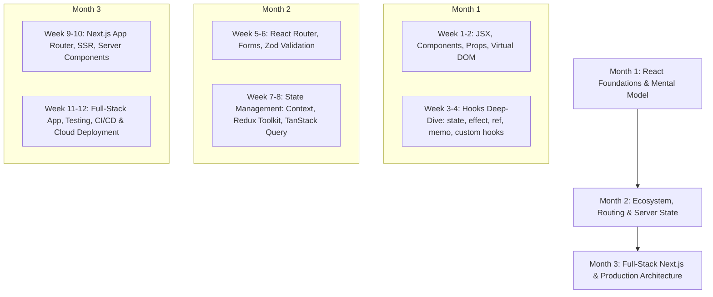

# ⚡ Flutter to React — Interactive Mastery Blueprint

[](https://fluttertoreact.vercel.app)
[](https://www.linkedin.com/in/mageshkanna/)
[](https://react.dev/)
[](https://vitejs.dev/)
[](LICENSE)

> A production-grade, interactive learning application meticulously engineered for **Flutter developers transitioning to React**. Every React hook, pattern, and architectural standard is mapped directly to its Flutter equivalent with live interactive playgrounds, line-by-line annotated source code, and a battle-tested 90-day roadmap.

🌐 **Live Production App:** [https://fluttertoreact.vercel.app](https://fluttertoreact.vercel.app)  
📁 **GitHub Repository:** [https://github.com/Magesh-kanna/flutter_to_react](https://github.com/Magesh-kanna/flutter_to_react)

---

## 🎯 Why This Project?

Flutter and React share the same fundamental philosophy: **Declarative UI where UI is a function of state** (`f(state) = UI`). However, the syntax, execution model, reactivity primitives, and DOM mental models differ significantly:

- **Flutter** draws every pixel onto an Skia/Impeller canvas with a 3-tree architecture (*Widget Tree*, *Element Tree*, *RenderObject Tree*).
- **React** reconciles lightweight JavaScript objects (Virtual DOM / Fiber Tree) and commits diffs to the browser's Real DOM.

This project bridges that gap by providing a side-by-side mental translation, working code samples, interactive demos, and real-world gotchas.

---

## 🧭 The Rosetta Stone: Flutter ↔ React Mental Model

| Flutter Concept | React Equivalent | Core Difference & Nuance |
| :--- | :--- | :--- |
| `StatelessWidget` | Function Component | Pure JavaScript function taking `props` and returning JSX. |
| `StatefulWidget` + `State` | Function Component + `useState` | No separate state class. State variables live inside the component closure. |
| `setState(() { ... })` | Setter function (`setCount(prev => prev + 1)`) | React state updates are scheduled and batched, not synchronous in-place mutations. |
| `initState()` | `useEffect(() => { ... }, [])` | Empty dependency array runs once after initial DOM mount. |
| `didUpdateWidget()` | `useEffect(() => { ... }, [dep])` | Runs whenever specified dependencies in the array change. |
| `dispose()` | `useEffect(() => () => { cleanup() }, [])` | Return a cleanup function from the effect callback. |
| `InheritedWidget` / `Provider` | `createContext` + `useContext` | Native hierarchical data passing without prop drilling. |
| `TextEditingController` | Controlled Input (`value` + `onChange`) | In React, inputs are driven by state or uncontrolled via `useRef`. |
| `FocusNode` / `GlobalKey` | `useRef` | Access raw DOM elements or preserve mutable values across renders without re-rendering. |
| `ListView.builder` | `items.map((item) => <Item key={item.id} />)` | Standard JS array transformation. `key` is essential for the reconciliation algorithm. |
| `FutureBuilder` / `StreamBuilder` | `useEffect` + fetch state OR TanStack Query | Managed via `loading`, `error`, and `data` states. |
| `const Widget()` | `React.memo(Component)` | Skips re-rendering if props are referentially shallow-equal. |
| Computed Getters (`int get total`) | `useMemo(() => compute(), [deps])` | Caches expensive calculations between re-renders. |
| VoidCallback (`Function()`) | `useCallback(() => fn(), [deps])` | Preserves function reference identity across parent re-renders. |
| `Column` / `Row` / `Expanded` | CSS Flexbox (`flex-direction: column / row`, `flex: 1`) | Native CSS layout engine. |
| `Navigator.push` / `GoRouter` | React Router (`useNavigate`, `<Routes>`, `<Route>`) | URL-driven history stack and client-side routing. |

---

## 🛠️ 13 Interactive Learning Modules

The app is broken down into 13 modular tabs with hands-on sandboxes and Flutter-annotated code:

1. **`useState` Playground**: Counter with step increments, batching demo, and state history.
2. **`Props & Children`**: Custom Card widgets demonstrating props, default values, and `children` (Flutter's `child` / `children`).
3. **`useEffect` Lifecycle Studio**: Visualizing mount, update, dependency triggers, and cleanup timers.
4. **`Lists & Keys` Explorer**: Dynamic list manipulation demonstrating why keys matter during DOM reconciliation.
5. **`Forms & Inputs`**: Controlled vs uncontrolled inputs, real-time validation, and submit handlers.
6. **`Context API`**: Global theme and user role state management without third-party libraries.
7. **`useRef & DOM`**: Directly focusing inputs, measuring DOM nodes, and tracking render counts without triggering re-renders.
8. **`useMemo & React.memo`**: Benchmark expensive prime calculations and demonstrate render skips.
9. **`Custom Hooks`**: Reusable headless logic (`useLocalStorage`, `useWindowSize`, `useDebounce`) equivalent to Flutter Mixins.
10. **`Async Data & API`**: Simulated network requests with loading spinners, error boundaries, and refresh controls (`FutureBuilder` pattern).
11. **`Flexbox Layout System`**: Side-by-side visual mapping of `MainAxisAlignment`, `CrossAxisAlignment`, `Expanded`, and `Spacer`.
12. **`Deep Q&A & Quiz`**: 15+ in-depth architecture questions, gotchas, interview puzzles, and knowledge check quizzes.
13. **`90-Day Roadmap & Cheat Sheet`**: Week-by-week curriculum taking a Flutter engineer to full-stack React competency.

---

## 🗺️ 90-Day Flutter-to-React Learning Roadmap



### 📅 Breakdown:
- **Phase 1 (Days 1–30): Foundation & Hooks**
  - Mastering JSX, functional paradigms, and closures.
  - Converting mental models from Flutter's `build(context)` to React's component execution model.
  - Hook rules, stale closures, dependency arrays, and cleanup functions.
- **Phase 2 (Days 31–60): The React Ecosystem**
  - Client-side routing with React Router 6.
  - Form handling with React Hook Form and schema validation with Zod.
  - Server state caching with TanStack Query (React Query) replacing manual `FutureBuilder` boilerplate.
  - Global state with Redux Toolkit / Zustand.
- **Phase 3 (Days 61–90): Production & Full-Stack**
  - Next.js (SSR, SSG, Server Actions, Server Components).
  - Web performance (Core Web Vitals, code-splitting, lazy loading).
  - TypeScript integration with strict types for props and state.
  - End-to-end testing with Vitest and Playwright.

---

## 📁 Project Architecture & Folder Structure

```
react_learnings/
├── .gitignore               # Git ignore configuration (including .vercel)
├── index.html               # Single HTML entrypoint (root DOM node)
├── package.json             # Dependencies and scripts (React 19, Vite 8)
├── vite.config.js           # Vite build & plugin configuration
├── README.md                # Comprehensive documentation
├── public/                  # Static assets served as-is
└── src/
    ├── main.jsx             # Entrypoint (ReactDOM.createRoot -> main.dart runApp)
    ├── App.jsx              # Root shell with Tab navigation & layout
    ├── App.css              # Clean, modern CSS variables & responsive layout
    ├── index.css            # Base reset, typography, and token variables
    ├── components/          # 13 Interactive modules & playgrounds
    │   ├── CounterDemo.jsx          # useState & batching
    │   ├── PropsDemo.jsx            # Props, children & composition
    │   ├── LifecycleDemo.jsx        # useEffect lifecycle transitions
    │   ├── ListDemo.jsx             # Lists, reconciliation & key prop
    │   ├── FormDemo.jsx             # Controlled inputs & validation
    │   ├── ContextDemo.jsx          # InheritedWidget / Context API
    │   ├── RefDemo.jsx              # useRef, focus & non-rendering state
    │   ├── MemoDemo.jsx             # Performance, useMemo, React.memo
    │   ├── CustomHookDemo.jsx       # Custom reusable hooks
    │   ├── AsyncDataDemo.jsx        # FutureBuilder async simulation
    │   ├── LayoutDemo.jsx           # Flexbox vs Flutter Layouts
    │   ├── QuestionsDeepDive.jsx    # Interview Q&A and interactive quiz
    │   └── RoadmapAndCheatSheet.jsx # 90-Day step-by-step roadmap
    └── context/
        └── ThemeContext.jsx         # Context provider for theme & user role
```

---

## 💻 Getting Started Locally

### Prerequisites
- Node.js (version 18.0 or higher)
- npm or pnpm or yarn

### 1. Clone the repository
```bash
git clone https://github.com/Magesh-kanna/flutter_to_react.git
cd flutter_to_react
```

### 2. Install dependencies
```bash
npm install
```

### 3. Start development server
```bash
npm run dev
```
Open your browser at `http://localhost:5173`.

### 4. Build for production
```bash
npm run build
```

### 5. Preview production build locally
```bash
npm run preview
```

---

## 🚢 Deployment

This project is configured for seamless zero-config deployment on **Vercel**:

```bash
# Deploy to preview
vercel

# Deploy to production
vercel --prod
```

---

## 🤝 Contributing

Contributions, feedback, and additional Flutter-to-React concept mappings are welcome!

1. Fork the Project
2. Create your Feature Branch (`git checkout -b feature/NewConcept`)
3. Commit your Changes (`git commit -m 'feat: Add useReducer vs BLoC guide'`)
4. Push to the Branch (`git push origin feature/NewConcept`)
5. Open a Pull Request

---

## 👤 Author

**Magesh K**  
- LinkedIn: [linkedin.com/in/mageshkanna](https://www.linkedin.com/in/mageshkanna/)  
- GitHub: [@Magesh-kanna](https://github.com/Magesh-kanna)  
- Live App: [fluttertoreact.vercel.app](https://fluttertoreact.vercel.app)
